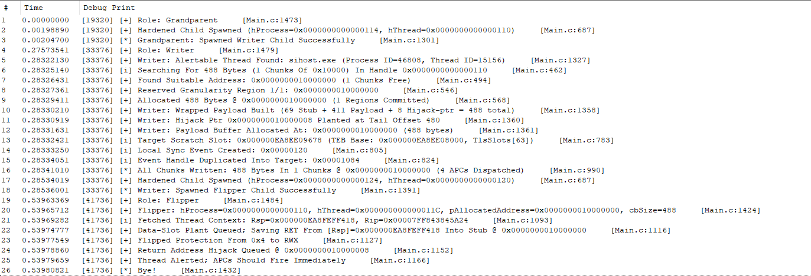
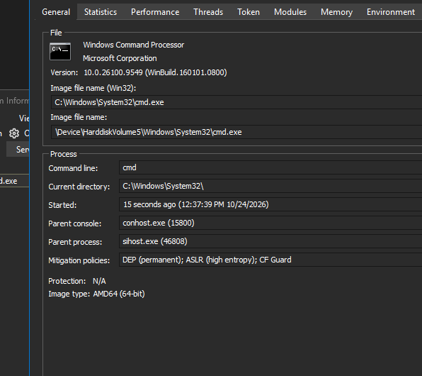

# WhisperHijack

A stealthy process injection PoC combining **Thread Name-Calling** for payload delivery with **Waiting Thread Hijacking** for execution, with zero cross-process writes.


## What Does It Do

Injects an x64 `cmd.exe` shellcode into a running 64-bit process and executes it on an existing waiting thread, without:

- `NtWriteVirtualMemory` / `WriteProcessMemory` on the payload
- `NtSetContextThread` / `SetThreadContext` on the target thread
- `NtSuspendThread` / `NtResumeThread`
- `NtCreateThreadEx` / `CreateRemoteThread`
- `PROCESS_VM_WRITE` access on the target process handle

The target process is left in a stable state. The hijacked thread executes the payload, then resumes its original caller.

<br>


## Acknowledgments
 
The two core techniques used here were introduced by **hasherezade** (Check Point Research):
 
- **Thread Name-Calling (TNC)** (July 2024): https://research.checkpoint.com/2024/thread-name-calling-using-thread-name-for-offense/
- **Waiting Thread Hijacking (WTH)** (April 2025): https://research.checkpoint.com/2025/waiting-thread-hijacking/

This project is an independent implementation of both techniques with modifications noted inline. All credit for the original research belongs to the author of those blogs.
 
<br>

## Architecture

The injection runs across three cooperating processes to break up the behavioral signature:

### 1. Grandparent (`GrandparentMain`)

Launches with no arguments. Spawns the Writer child via `NtCreateUserProcess` with `MITIGATION_POLICY_HARDENED` (if enabled) and exits.

### 2. Writer (`WriterChildMain`)

1. Enumerates the system via `NtQuerySystemInformation(SystemProcessInformation)` and finds an alertable waiting thread (`ThreadState == Waiting && WaitReason == WrQueue`) in a non-WoW64 64-bit process.

2. Opens the target with the minimum rights: `PROCESS_VM_OPERATION | PROCESS_VM_READ | PROCESS_QUERY_INFORMATION | PROCESS_DUP_HANDLE`. **No `PROCESS_VM_WRITE`.**

3. Composes a wrapped payload: `[WTH stub (0x45 bytes)][main shellcode][8-byte hijack pointer at tail]`.

4. Allocates a granularity-sized region in the target as `PAGE_READWRITE` (via `AllocateVirtualMemory` -> `FindSuitableAddress`).

5. Plants the hijack pointer (= `pAllocatedAddress + WTH_STUB_CODE_OFFSET`) into the tail of the wrapped payload before delivery.

6. Delivers the full wrapped payload into the target via **Thread Name-Calling** (`WriteMemoryViaThreadNameApc`).

7. Spawns the Flipper child with inherited handles for the target process and thread.

### 3. Flipper (`FlipperChildMain`)

1. Receives `hProcess`, `hThread`, `pAllocatedAddress`, and `cbSize` on its command line.

2. Fetches the thread's `Rsp` via `NtGetContextThread(CONTEXT_CONTROL)`; RSP is the only register field needed.

3. Queues an in-target `RtlMoveMemory` APC that copies the saved RET from `[Rsp]` into the stub's data slot at `pAllocatedAddress[0..7]`.

4. Flips the target region from `PAGE_READWRITE` to `PAGE_EXECUTE_READWRITE` via `NtProtectVirtualMemory`. **RWX is required because the shellcode is polymorphic and self-decoding.**

5. Queues an in-target `RtlMoveMemory` APC that copies the pre-planted hijack pointer from the tail into `[Rsp]`.

6. Calls `NtAlertThread` to force the APC drain. FIFO ordering guarantees the data slot is populated before `[Rsp]` is rewritten.

<br>

## Granularity-based Allocation

Allocation granularity is the minimum alignment boundary at which Windows places a reserved virtual memory region. On x86/x64 this is always 64 KB (`0x10000`). `VirtualAlloc` / `VirtualAllocEx` silently rounds any base address DOWN to the nearest 64 KB boundary, meaning two regions cannot be reserved closer than 64 KB apart regardless of how small each one is. This is distinct from the page size (4 KB), which is the minimum unit of commit and protection.

For example, calling `VirtualAllocEx` for 1 byte at `0x00401001` makes Windows round down to `0x00400000` and reserve the entire 64 KB block from `0x00400000` to `0x0040FFFF`. The remaining space in that block is unusable by any other allocation until the whole region is freed.

This project operates deliberately on granularity boundaries. The payload region is placed in one or more 64 KB blocks at a predictable address, and each block is built up page by page instead of in a single combined `MEM_RESERVE | MEM_COMMIT` call. The two subsections below cover how the base is picked and how the per-page commits are shaped.

### Address selection (`FindSuitableAddress`)

The target base is picked from a fixed list of candidate addresses (`0xDDDD0000`, `0x10000000`, `0x21000000`, ... `0xCCCC0000`). The first candidate whose required span of granularity-sized chunks is entirely `MEM_FREE` (probed with `NtQueryVirtualMemory(MemoryBasicInformation)`) wins. 

### Allocation shape (`AllocateVirtualMemory`)

For each granularity-sized region (64 KB on x64) the payload needs:

1. `NtAllocateVirtualMemory(MEM_RESERVE, PAGE_NOACCESS)` reserves the full 64 KB as inaccessible.
2. For each 4 KB page inside that region, `NtAllocateVirtualMemory(MEM_COMMIT, <requested protection>)` commits it individually.

<br>

## Thread Name-Calling (TNC)

> **Based on:** [Thread Name-Calling blog (Check Point, 2024)](https://research.checkpoint.com/2024/thread-name-calling-using-thread-name-for-offense/).

TNC smuggles the payload into the target by abusing the thread description API (`ETHREAD->ThreadName`), which allocates its backing buffer in kernel non-paged pool with tag `'ThNm'`.

### Per-chunk chain

Each chunk (up to `MAX_THREAD_NAME_LEN = 0xFFFE` bytes) is delivered as:

```
1.             NtSetInformationThread(ThreadName)       : Stash chunk into ETHREAD->ThreadName
2. (APC #1)    [RtlFillMemory(scratch, 8, 0)]           : Zero scratch slot in-target
3. (APC #2)    [GetThreadDescription(-2, scratch)]      : Target heap-allocates, writes buffer ptr to scratch
4. (APC #3)    [NtSetEvent(hRemoteEvent)]               : Signal Writer from in-target
5.             NtWaitForSingleObject(hLocalEvent)       : Block until APC #3 fires
6.             NtReadVirtualMemory(scratch)             : Pull the heap pointer back
7. (APC #4)    [RtlMoveMemory(dst, heapPtr, len)]       : Copy heap stash to final destination
8.             NtAlertThread                            : Drain APC #4 before the next iteration
```

### Null-byte workaround

`RtlInitUnicodeString` sets `Length` by scanning for `L'\0'`, which would truncate shellcode containing embedded nulls. We workaround this by seeding the `UNICODE_STRING` with an `'A'`-filled buffer of the exact chunk size, then overwrite `Buffer` with the real bytes before the syscall. 

### Scratch slot - three options

The in-target `GetThreadDescription` APC needs a known fixed address in the target to drop its heap pointer. Three options are provided; enable exactly one at the top of the file:

| Option | Field                               | Pros                                   | Cons                             |
|--------|-------------------------------------|----------------------------------------|----------------------------------|
| 1      | `PEB.SpareUlongs`                   | Never used by Windows                  | Same slot as hasherezade's PoC   |
| 2      | `PEB.PostProcessInitRoutine`        | Dead after process init, no extra API  | Documented field                 |
| 3      | `TEB.TlsSlots[63]` (default)        | Different fingerprint, dodges PEB      | Needs `NtQueryInformationThread` |

A compile-time `C_ASSERT` validates each slot. Attempting to compile with none (or both) raises an `#error`.

### Synchronization

The Writer and the target coordinate through a sync event. `NtCreateEvent` creates a local `SynchronizationEvent` (auto-reset); `NtDuplicateObject` mirrors its handle into the target so the in-target APC chain can signal it. `NtSetEvent` runs as the
last APC in each chunk's FIFO sequence (APC #3), after the scratch slot has been populated by `GetThreadDescription`. The Writer's `NtWaitForSingleObject(hLocalEvent)` returns at that point, and `NtReadVirtualMemory` pulls the heap pointer out of the
scratch slot. 

<br>


## Waiting Thread Hijacking (WTH)

> **Based on:** [Waiting Thread Hijacking blog (Check Point, 2025)](https://research.checkpoint.com/2025/waiting-thread-hijacking/).

WTH overwrites the saved RET of a thread blocked in `NtWaitForWorkViaWorkerFactory` (worker factory wait, reason `WrQueue`). When the thread's wait returns, the syscall wrapper's `ret` pops the overwritten slot and lands on the WTH stub.

### The WTH stub (69 bytes)

```
[+0x00 .. +0x07]  : 8-byte data slot (saved original RET, filled by Flipper APC)
[+0x08 .. +0x44]  : pushf + push all GPRs + call +0x1F + pop all GPRs + popf
                    + jmp qword ptr [rip-0x45]  (= jmp qword ptr [data slot])
[+0x45 ..      ]  : user payload (must end on a 'ret')
```

Execution flow:
1. Thread's `ret` lands on `pushf` at stub+0x08.
2. All GPRs and flags are saved.
3. `call +0x1F` jumps into the user payload at `+0x45`.
4. Payload runs, ends with `ret`, returning to the stub's epilogue.
5. GPRs and flags are restored.
6. Final `jmp qword ptr [rip-0x45]` dereferences the data slot and jumps to the original RET.
7. The original caller receives control with full state preserved, and the host thread continues normally.


### Zero-Write Hijack

Every memory operation the Flipper performs on the target happens in-target, via APC. The Flipper's only cross-process call is the `NtProtectVirtualMemory` flip from `PAGE_READWRITE` to `PAGE_EXECUTE_READWRITE`.

The sequence:

1. `NtGetContextThread(CONTEXT_CONTROL)` fetches `Rsp`.
2. In-target `RtlMoveMemory` APC copies the 8-byte saved RET from `[Rsp]` into the stub's data slot at `pAllocatedAddress[0..7]`. The Flipper never fetches the saved RET value in its own memory.
3. `NtProtectVirtualMemory` flips the region to RWX.
4. In-target `RtlMoveMemory` APC copies the pre-planted hijack pointer from the buffer's tail (`pAllocatedAddress + cbSize - 8`) into `[Rsp]`. The pointer was baked into the tail by the Writer during TNC delivery, so no cross-process write is needed to transmit it here.
5. `NtAlertThread` forces the APC drain. Which forces the payload to run instead of waiting for the thread to wake naturally on its next work item, event, or IOCP packet.


<br>

## Supporting Infrastructure

- **Indirect syscalls** via `IndirectSyscalling.h` - all Nt* calls go through `INITIALIZE_SYSCALL` / `INVOKE_SYSCALL` macros.
- **API hashing** via `ResolveAPIs.h` using **CRC-32B**. Both case-sensitive (`HashStringCrc32bA` / `HashStringCrc32bW` for API export names) and case-insensitive (`HashIStringCrc32bA` / `HashIStringCrc32bW` for module names) variants are provided. See [github.com/Maldev-Academy/ApiHashing](https://github.com/Maldev-Academy/ApiHashing).
- **Hash regeneration** via the included `Crc32bHasher.py`:
  ```
  python Crc32bHasher.py NtOpenProcess NtClose RtlFillMemory      # case-sensitive (APIs)
  python Crc32bHasher.py -i ntdll.dll kernel32.dll                # case-insensitive (modules)
  ```
  Output is ready to paste into `Common.h` as `CRC32B_*` defines.
- **Unguard gadget** via `ReadThroughGadgets.h` to allow reading guarded memory for EAF-enabled targets.
- **Granularity-based allocation** (`FindSuitableAddress` + `AllocateVirtualMemory`) that reserves a region at a predictable candidate base, then commits individual pages. 
- **Hardened child spawning** via `NtCreateUserProcess` with `MITIGATION_POLICY_HARDENED` and `PS_ATTRIBUTE_HANDLE_LIST` for cross-process handle inheritance.

<br>


## Shellcode

The embedded payload is a polymorphic x64 `cmd.exe` generated by:

```
AlphabeticalPolyGen.exe --i x64CmdShellcode.bin --o x64CmdShellcode.bin.poly
```

See [github.com/Maldev-Academy/AlphabeticalPolyShellGen](https://github.com/Maldev-Academy/AlphabeticalPolyShellGen). 

The original (non-poly) shellcode is kept commented out in the source for reference.

<br>

## Behavioral Fingerprint

Per injection (N = payload chunk count; P = pages in allocation):

| Operation                                | Count     | Where                      |
|------------------------------------------|-----------|----------------------------|
| `NtWriteVirtualMemory` on target         | **0**     | -                          |
| `NtSetContextThread` on target thread    | **0**     | -                          |
| `NtSuspendThread` / `NtResumeThread`     | **0**     | -                          |
| `NtCreateThread*` on target              | **0**     | -                          |
| `NtQueueApcThread` on target thread      | 4N + 2    | TNC per chunk + 2 for WTH  |
| `NtAlertThread` on target thread         | N + 1     | TNC drain + WTH drain      |
| `NtReadVirtualMemory` on target          | N         | TNC scratch slot read      |
| `NtProtectVirtualMemory` on target       | 1         | WTH RW -> RWX flip         |
| `NtAllocateVirtualMemory` on target      | 1 + P     | Reserve + per-page commit  |
| `NtSetInformationThread(ThreadName)`     | N + 1     | TNC chunk stash + clear    |

Writer-side (not touching the target): `NtCreateEvent` x1, `NtDuplicateObject` x1 (into target), `NtWaitForSingleObject` xN.

<br>

## Demo
 
Tested successfully against `sihost.exe` on Windows 11 24H2.
 
**Full injection trace**: DebugView output showing the Grandparent -> Writer -> Flipper chain, Thread Name-Calling delivery into sihost.exe, and the WTH APC hand-off:
 

 
**Outcome**: `cmd.exe` spawned as a direct child of `sihost.exe` (PID 46808, the hijacked process). The host thread resumed normally; sihost.exe did not crash:
 

 

<br>


## References

- **Thread Name-Calling** - https://research.checkpoint.com/2024/thread-name-calling-using-thread-name-for-offense/
- **Waiting Thread Hijacking** - https://research.checkpoint.com/2025/waiting-thread-hijacking/
- **ApiHashing** - https://github.com/Maldev-Academy/ApiHashing
- **AlphabeticalPolyShellGen** - https://github.com/Maldev-Academy/AlphabeticalPolyShellGen

